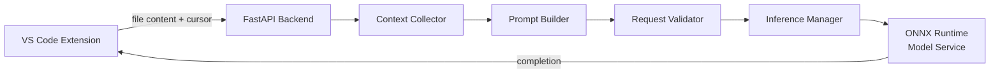

<div align="center">

# Dockerfile Autocomplete

**Inline, Copilot-style completions for Dockerfiles, from an 80.8M-parameter transformer I trained from scratch, running entirely on your own CPU.**

  -green.svg) 

[Project site](https://dockerautocomplete.netlify.app/) · [Model weights on Hugging Face](https://huggingface.co/S-ABISHEAK/dockerfile-lm) · [Docker image](https://hub.docker.com/r/sabisheak27/dockerfile-autocomplete)

</div>

---

## Contents

- [What is this](#what-is-this)
- [See it work](#see-it-work)
- [How it works](#how-it-works)
- [The model](#the-model)
- [How it was trained](#how-it-was-trained)
- [Quickstart](#quickstart)
- [Build from source](#build-from-source)
- [Performance](#performance)
- [Configuration](#configuration)
- [What I learned along the way](#what-i-learned-along-the-way)
- [Known limitations](#known-limitations)
- [Roadmap](#roadmap)
- [Project structure](#project-structure)
- [Why local, not cloud](#why-local-not-cloud)
- [License](#license)

---

## What is this

I wanted the experience of GitHub Copilot, but for one narrow thing I write constantly: Dockerfiles. Instead of calling a big general-purpose model through an API, I trained a small transformer from scratch on Dockerfile, YAML and Terraform (HCL) files, exported it to ONNX, and wrapped it in a VS Code extension.

- **Ghost-text suggestions as you type.** Press `Tab` to accept, keep typing to dismiss.
- **100% local.** No account, no API key, no billing, and your code never leaves your machine.
- **CPU only.** No GPU and no CUDA drivers. The model file is 409 MB.
- **Self-contained.** Run the backend as a Docker container, or straight from source.

This is a small model, and I've tried to be honest about what that means. See [Known limitations](#known-limitations) before you form expectations.

## See it work

These are real outputs from the shipped model (`dockerfile-lm-v1`), generated with the repo's own [quality-check script](scripts/phase0_quality_check.py). Text after the cursor `▮` is the completion.

| You typed | Model suggested |
|---|---|
| `FROM ubuntu:22.04`<br>`RUN apt-▮` | `get update && apt-get install -y --no-install-recommends \` |
| `FROM python:3.11-slim`<br>`ENV PATH=▮` | `${PATH}:/opt/app` |
| `…COPY . .`<br>`CMD [▮` | ` "python", "./app.py" ]` |
| `FROM python:3.11-slim`<br>`WORKDIR /app`<br>`RUN▮` | ` pip install --upgrade pip` |

It also stumbles in predictable ways: it repeats itself (for example `ENV POSTGRES_PASSWORD=postgres` several times in a row), and it can be wrong about versions. I cover this properly under [What I learned along the way](#what-i-learned-along-the-way).

## How it works



The extension is deliberately thin: it captures editor state and renders ghost text. Every real decision happens in the backend.

| Stage | What it does |
|---|---|
| **Extension** | Uses VS Code's native inline-completion API. It waits 300 ms after you stop typing, and cancels the in-flight request the moment you type again, so stale suggestions never pile up. |
| **Context collector** | Takes only the text *before* the cursor, capped at the last 4,000 characters. It never ships the whole file. |
| **Prompt builder** | Normalises line endings, tokenises, and keeps the last 64 tokens (see [Performance](#performance) for why 64). |
| **Validator** | Rejects an out-of-range cursor or an empty prefix with a structured JSON error (HTTP 400) before the model is touched. |
| **Inference manager** | Funnels every request through one worker thread so a slow model call can never block the async web server, and enforces a request timeout (HTTP 504). |
| **Model service** | Runs the ONNX Runtime session with greedy decoding. It stops at an end-of-text token, at a blank line, or after 20 new tokens. |

## The model

| | |
|---|---|
| Parameters | **80,792,576** (80.8M, tied embeddings counted once) |
| Architecture | Decoder-only transformer: RMSNorm, RoPE, grouped-query attention (8 query heads / 2 KV heads), SwiGLU feed-forward, tied input/output embeddings, no biases |
| Layers / hidden size | 20 / 512 (head size 64, feed-forward width 1365) |
| Context length | 256 tokens trained; **64 tokens used at inference** |
| Tokenizer | GPT-2 byte-pair encoding via `tiktoken`, vocabulary of 50,257. No custom vocabulary and no fill-in-the-middle tokens. |
| Shipped weights | `dockerfile-lm-v1`, training step **105,000** |
| Export | ONNX opset 18, dynamic batch and sequence axes, fp32 (no quantisation), 409 MB |

It is trained entirely from scratch, not fine-tuned from any existing base model. The architecture is defined in [`model/architecture.py`](model/architecture.py).

## How it was trained

The training notebooks run on Kaggle and live outside this repo, so the numbers below come from those notebooks and from the saved checkpoints. Where something was not recorded, I say so rather than guess.

**Data.** `bigcode/the-stack-dedup` (the deduplicated release of The Stack), streaming three languages interleaved: `dockerfile`, `yaml` and `hcl`. So it is a *DevOps config* model, not Dockerfiles only. Cleaning is minimal and deliberate: normalise line endings, trim surrounding newlines, and append an end-of-text token to each file. Whitespace and non-ASCII characters are preserved because they are meaningful in config files. I did no deduplication of my own beyond what The Stack already provides. Each round holds the next slice of the stream (logged chunk sizes: 336.9M tokens for round 0 and 359.1M for round 1), split 90% train and 10% validation.

**Training loop.** The corpus is far too big to tokenise or train on in one sitting, and Kaggle sessions have hard time limits, so training runs in resumable rounds:

- 7 rounds of 15,000 steps gave the shipped checkpoint (105,000 steps). Each round tokenises its own slice, trains, and saves a checkpoint with the optimiser state.
- One continuous learning-rate schedule spans every round (no re-warm-up at round boundaries): 1,000-step warm-up to 3e-4, then cosine decay towards 3e-5.
- AdamW (betas 0.9/0.95, weight decay 0.1 on weight matrices only, none on norms or embeddings), gradient clipping at 1.0.
- fp16 mixed precision with a gradient scaler, gradient checkpointing, and PyTorch's fused scaled-dot-product (flash) attention.
- Hardware: a single NVIDIA T4 (from the notebook metadata).
- Batches of 256-token sequences. The early notebook used 16 per step and later ones 32. I did not record exactly when it changed.

**Logged validation loss** (cross-entropy per token; lower is better):

| Step | Train | Val |
|---:|---:|---:|
| 0 | 10.88 | 10.90 |
| 5,000 | 2.67 | 2.91 |
| 10,000 | 2.25 | 2.58 |
| 14,000 | 2.26 | 2.45 |
| 120,000 | 1.71 | 1.94 |
| 139,000 | 1.42 | 1.84 |

Two honest caveats. The log lines for steps 15,000 to 119,000 were not saved, and the 120,000+ rows come from a later continuation run (which added dropout 0.2 and a learning-rate restart), not from the exact run that produced the shipped step-105,000 weights. I also have no held-out benchmark such as exact-match or next-line accuracy yet. That is the top item on the [roadmap](#roadmap).

## Quickstart

Pick **one** way to run the backend. All of them listen on port **8123** and need no cloud account.

### 1. Start the backend

**Option A: Docker (recommended)**

```bash
docker pull sabisheak27/dockerfile-autocomplete:latest

# keep it in the foreground (Ctrl+C to stop):
docker run --rm -p 127.0.0.1:8123:8080 sabisheak27/dockerfile-autocomplete:latest

# ...or run it in the background:
docker run -d --rm --name dockerfile-autocomplete -p 127.0.0.1:8123:8080 sabisheak27/dockerfile-autocomplete:latest
docker stop dockerfile-autocomplete
```

The `127.0.0.1:` part matters. It keeps the server reachable only from your own machine. Without it, Docker publishes the port on every network interface. The image is `linux/amd64`, about 1.2 GB on disk, with the model baked in.

**Option B: from source (no Docker)**

Needs Python 3.10 or newer, plus a little over 400 MB of disk for the model and packages. The first run also needs internet once, so `tiktoken` can download and cache its tokenizer file.

```bash
git clone https://github.com/S-ABISHEAK/docker_autocomplete_copilot.git
cd docker_autocomplete_copilot

python3 -m venv .venv
source .venv/bin/activate            # Windows: .venv\Scripts\activate
pip install -r requirements-serve.txt huggingface_hub

python scripts/fetch_model.py        # downloads dockerfile-lm-v1.onnx (~409 MB) into model/checkpoints/
python scripts/run_server.py         # serves on http://127.0.0.1:8123
```

> A pre-built standalone binary isn't published on GitHub Releases yet. If you'd rather have a single executable, see [Build the standalone binary](#build-the-standalone-binary).

### 2. Check that it's actually running

In a second terminal:

```bash
curl http://127.0.0.1:8123/health
# {"status":"ready"}
```

If that fails, stop here and fix it first. Nothing later works without it. Check that Docker is running and that port 8123 isn't already taken.

Then ask for a real completion. This one-liner computes the cursor offset for you, which is the easy thing to get wrong by hand:

```bash
python3 -c 'import json; s="FROM python:3.11-slim\n\nWORKDIR /app\nRUN"; print(json.dumps({"file_content": s, "cursor_offset": len(s)}))' \
  | curl -s -X POST http://127.0.0.1:8123/complete -H "Content-Type: application/json" -d @-
# {"completion":" pip install --upgrade pip\n\n"}
```

### 3. Install the VS Code extension

Requires VS Code 1.85 or newer. The packaged extension is [`extension/dockerfile-autocomplete-0.1.0.vsix`](extension/dockerfile-autocomplete-0.1.0.vsix).

```bash
# if you cloned the repo:
code --install-extension extension/dockerfile-autocomplete-0.1.0.vsix

# or download just the file first:
curl -L -o dockerfile-autocomplete.vsix \
  https://github.com/S-ABISHEAK/docker_autocomplete_copilot/raw/main/extension/dockerfile-autocomplete-0.1.0.vsix
code --install-extension dockerfile-autocomplete.vsix
```

Prefer the UI? Open Extensions (`Ctrl+Shift+X`), click **`…`** at the top of the panel, choose **Install from VSIX…**, and select the file. Then reload VS Code.

### 4. Open a Dockerfile

Create a file named `Dockerfile` (no extension), or any `.dockerfile`. Look at the **bottom-right status bar**: it must say **Dockerfile**. If it says "Plain Text", click it and pick *Dockerfile*. The extension only activates for that language mode.

### 5. Use it

```dockerfile
FROM python:3.11-slim

WORKDIR /app
RUN
```

Pause for a moment after `RUN`. Faint grey ghost text should appear. Press **Tab** to accept it, or keep typing to dismiss it.

> **Tip:** type the keyword and *stop*, with no trailing space. The model works noticeably better that way. See [the trailing-space finding](#what-i-learned-along-the-way) for why.

### If nothing shows up

1. Is the backend still running? Re-run `curl http://127.0.0.1:8123/health`.
2. Does the status bar say **Dockerfile**, not "Plain Text"?
3. Is `dockerfileAutocomplete.enabled` true? Press `Ctrl+,` and search for "dockerfile autocomplete".
4. Is the extension pointing at the right place? `dockerfileAutocomplete.backendUrl` defaults to `http://127.0.0.1:8123`. If you mapped a different port, change it.
5. Open the Output panel (`Ctrl+Shift+U`), choose **Log (Extension Host)** in the dropdown, and look for errors.
6. Getting timeouts on a slow machine? Raise `dockerfileAutocomplete.requestTimeoutMs` (default 5000).

## Build from source

### Run the extension in development

```bash
cd extension
npm ci
npm run compile          # TypeScript -> out/
```

Then open the `extension/` folder in VS Code and press **F5** to launch an Extension Development Host with the extension loaded.

### Package the extension yourself

```bash
cd extension
npm ci
npm run compile
npx @vscode/vsce package --allow-missing-repository --no-dependencies
# -> dockerfile-autocomplete-0.1.0.vsix
```

### Build the Docker image locally

The image bakes in the model, so fetch it first:

```bash
python scripts/fetch_model.py        # needs: pip install huggingface_hub
docker build -t dockerfile-autocomplete:local .
docker run --rm -p 127.0.0.1:8123:8080 dockerfile-autocomplete:local
```

### Build the standalone binary

This produces one self-contained executable (Linux build, about 430 MB). `torch` is deliberately excluded to keep it small.

```bash
pip install -r requirements-serve.txt pyinstaller huggingface_hub
python scripts/fetch_model.py

# the spec bundles the tokenizer cache, so create it once:
TIKTOKEN_CACHE_DIR=.tiktoken_cache python -c "import tiktoken; tiktoken.get_encoding('gpt2')"

pyinstaller dockerfile-autocomplete-server.spec
./dist/dockerfile-autocomplete-server        # serves on http://127.0.0.1:8123
```

### Re-export the model (only if you have a checkpoint)

You don't need this to use the project. It converts a PyTorch checkpoint to ONNX and checks that the two agree token for token:

```bash
pip install -r requirements.txt      # includes CPU PyTorch
python scripts/export_onnx.py        # model/checkpoints/dockerfile-lm-v1.pt -> .onnx
python scripts/benchmark_onnx.py     # greedy-decode parity check + ms/token, PyTorch vs ONNX
python scripts/phase0_quality_check.py   # 15 realistic prompts through the production path
```

## Performance

All numbers are on CPU, with no GPU involved.

| | Result |
|---|---|
| Per-token generation (my earlier dev-laptop measurement) | ~43–45 ms |
| Per-token generation (re-run for this README, Nov 2026, 15 prompts / 209 tokens, i5-13420H, machine under load) | **74.4 ms average** |
| Typical completion latency | ~0.7–1.4 s in my earlier measurement; individual completions in the re-run ranged from 0.1 s (stopped after one token) to 3.1 s (long prompt, 20 tokens) |
| Docker end-to-end, `RUN` prompt (`curl`, warm) | 0.49 s |
| Standalone binary, first request after start | 0.86 s |
| First request after startup | adds a one-time warm-up (~450–500 ms in my earlier measurements) |

The spread between 44 ms and 74 ms is real. It depends on the machine's load, thermal state and prompt length, so treat this as a ballpark rather than a benchmark.

**Why the context window is 64 tokens, not 256.** The exported graph has **no KV cache**: for every new token it recomputes attention over the whole window. Cost therefore climbs steeply with window size. I measured roughly 550 ms per completion at 64 tokens versus 1.7–3.9 s at 200 tokens. I capped the deployed window at 64 to keep typing latency predictable. Adding a KV cache is the single biggest improvement still available (see [Roadmap](#roadmap)).

Other numbers: stripping the optimiser state took the training checkpoint from 927 MB to 310 MB; the fp32 ONNX file is 409 MB; the Docker image is 1.23 GB on disk (492 MB compressed); the standalone binary is 430 MB. I verified that the ONNX weights are identical to the source checkpoint, and `benchmark_onnx.py` checks that greedy decoding matches PyTorch token for token.

## Configuration

**Backend environment variables**

| Variable | Default | Meaning |
|---|---|---|
| `MODEL_ONNX_PATH` | bundled model | Path to the ONNX weights |
| `CONTEXT_WINDOW_TOKENS` | `64` | How much preceding text the model sees. Larger means more context but much slower, because there is no KV cache. |
| `MAX_NEW_TOKENS` | `20` | Maximum tokens generated per completion |
| `REQUEST_TIMEOUT_SECONDS` | `5.0` | Server-side generation timeout |
| `BLOCK_SIZE` | `256` | Model's trained context length. Don't change this. |
| `EOT_TOKEN_ID` | `50256` | End-of-text token id. Don't change this. |
| `PORT` | `8123` (source / binary), `8080` (inside Docker) | Port the server listens on |

Example: `PORT=9000 CONTEXT_WINDOW_TOKENS=96 python scripts/run_server.py`. Docker passes variables with `-e`, for example `docker run -e MAX_NEW_TOKENS=30 …`.

**Extension settings** (`Ctrl+,` → "Dockerfile Autocomplete")

| Setting | Default | Meaning |
|---|---|---|
| `dockerfileAutocomplete.enabled` | `true` | Turn completions on or off |
| `dockerfileAutocomplete.backendUrl` | `http://127.0.0.1:8123` | Where completion requests are sent |
| `dockerfileAutocomplete.debounceMs` | `300` | Pause after typing stops before asking for a completion |
| `dockerfileAutocomplete.requestTimeoutMs` | `5000` | Client-side request timeout |

**API**

| Endpoint | Purpose |
|---|---|
| `GET /health` | Returns `{"status":"ready"}` |
| `POST /complete` | Body: `{"file_content": "...", "cursor_offset": <character index>}`. Returns `{"completion": "..."}`. Errors: `400 invalid_request` (bad offset or empty prefix), `504 timeout`. |

## What I learned along the way

The parts that did not go smoothly taught me the most, so here they are.

**1. A trailing space made the model go blank.** In my 15-prompt quality check, 7 prompts came back as *only whitespace* (five returned a line of spaces, two a bare blank line). Every one of them ended with a space (`COPY requirements.txt `, `FROM `, `USER `). One other prompt that ended in a space did work, but it produced a doubled space (`RUN  npm install`). My explanation is tokenisation: in GPT-2 BPE a lone trailing space is its own token, whereas in real training text the space is attached to the *next* word (` python`). So a trailing space puts the model in a situation it almost never saw. I tested this by stripping that one space before generating, and the same prompts produced real answers: `FROM ` → ` python:3.8-slim`, `USER ` → ` app`, `EXPOSE ` → ` 80`. The shipped backend doesn't handle this yet, which is why the quickstart says to stop right after the keyword. The extension also hides blank suggestions. A fix is on the [roadmap](#roadmap).

**2. No KV cache shapes the whole product.** The simplest correct ONNX export has no cache, so latency grows with the window. That one fact explains the 64-token window, the 20-token generation cap, and the fact that the model can't see your whole file. I chose to ship something responsive and honest rather than something that looks smarter but lags.

**3. Small models repeat themselves.** Greedy decoding with an 80M model loops easily. In the quality check it wrote the same `ENV POSTGRES_PASSWORD=postgres` line several times, and repeated `--timeout=3s`. Stopping at a blank line and capping at 20 tokens contains the damage, but it is a model-quality limit, not a bug I can patch around.

**4. Serving doesn't need PyTorch.** Moving inference to ONNX Runtime meant the runtime image carries only `fastapi`, `uvicorn`, `onnxruntime`, `tiktoken` and `numpy`. The checkpoint shrank from 927 MB to 310 MB once the optimiser state was dropped. The Docker image and the PyInstaller binary both leave `torch` out.

**5. Session limits force good engineering.** Kaggle sessions can end at any time, so the training loop checkpoints every 1,000 steps and derives its place in the schedule from the global step. A session dying costs minutes, not days.

**6. A fine-tuning experiment that taught me about vocabularies.** I also built a LoRA pipeline to fine-tune Qwen2.5-Coder-0.5B on the same corpus (see [`finetuned_model/`](finetuned_model/)). It has not been run to a finished result, so there is no comparison yet. Building it surfaced real bugs: packing token ids as `uint16` silently corrupts a 152k-token vocabulary (it needs `uint32`); the logits tensor for a big vocabulary, not the attention, was what ran the GPU out of memory (about 30 GB at the first settings); and forking CUDA workers from a notebook kernel crashes, so training launches as a separate process.

## Known limitations

I'd rather you hear these from me:

- **It's a small model.** Expect plausible, idiomatic Dockerfile lines, not guaranteed-correct ones. Always read what you accept, especially base-image tags and versions.
- **Short memory.** It sees the last 64 tokens before the cursor, only from the current file. No project context, no other files.
- **Trailing-space blanks** (see above) until the fix lands.
- **Greedy and repetitive.** No sampling, and it sometimes repeats lines.
- **Latency is fractions of a second to a couple of seconds**, not instant, and varies with your CPU.
- **No formal benchmark yet.** I haven't measured exact-match or next-line accuracy against a held-out set. The loss numbers above are the only quantitative evidence, and they aren't a substitute.
- **Mixed training data.** The model learned from Dockerfiles, YAML and Terraform together, so it can drift into another format. In my training-time samples, after an end-of-text token it happily started a YAML file.
- **Platforms.** The Docker image is `linux/amd64`. The standalone binary is a Linux build, and no Windows or macOS binaries exist yet. The source install works anywhere Python and `onnxruntime` do.
- **No authentication on the local server.** That's fine bound to `127.0.0.1`. Don't expose it to a network.

## Roadmap

Planned, not promised:

- [ ] Handle the trailing-space tokenisation boundary in the prompt builder.
- [ ] Export with a **KV cache** so the context window can approach the trained 256 tokens at low latency.
- [ ] Build a held-out evaluation (perplexity, exact-match and next-line accuracy) and publish the results.
- [ ] Export and compare the later checkpoints (steps 120,000 and 140,000) against v1.
- [ ] Finish and evaluate the Qwen2.5-Coder-0.5B LoRA experiment, with int8 quantisation if it needs it.
- [ ] Publish a GitHub Release with the Linux binary and the `.vsix`, plus Windows/macOS builds.
- [ ] Add the training notebooks to this repo.
- [ ] Publish the extension to the VS Code Marketplace.

## Project structure

```
docker_auto_complete/
├── backend/                 FastAPI service: api, context, prompt, validation, inference
├── model/                   architecture, tokenizer; ONNX weights land in model/checkpoints/
├── extension/               VS Code extension (TypeScript) and the packaged .vsix
├── scripts/                 fetch_model, export_onnx, benchmark_onnx, strip_checkpoint,
│                            phase0_quality_check, run_server
├── finetuned_model/         Qwen2.5-Coder-0.5B LoRA fine-tuning notebook (experiment)
├── docs/                    the project showcase site
├── Dockerfile               runtime image (ONNX Runtime only, no PyTorch)
└── dockerfile-autocomplete-server.spec    PyInstaller recipe for the standalone binary
```

## Why local, not cloud

Running on your own machine was the point, not a limitation. There are no billing surprises, no account to create, no server that has to stay online, and your source code never leaves your laptop. A small model is what makes that possible: it's light enough that the cloud isn't needed in the first place.

## License

[MIT](LICENSE)
